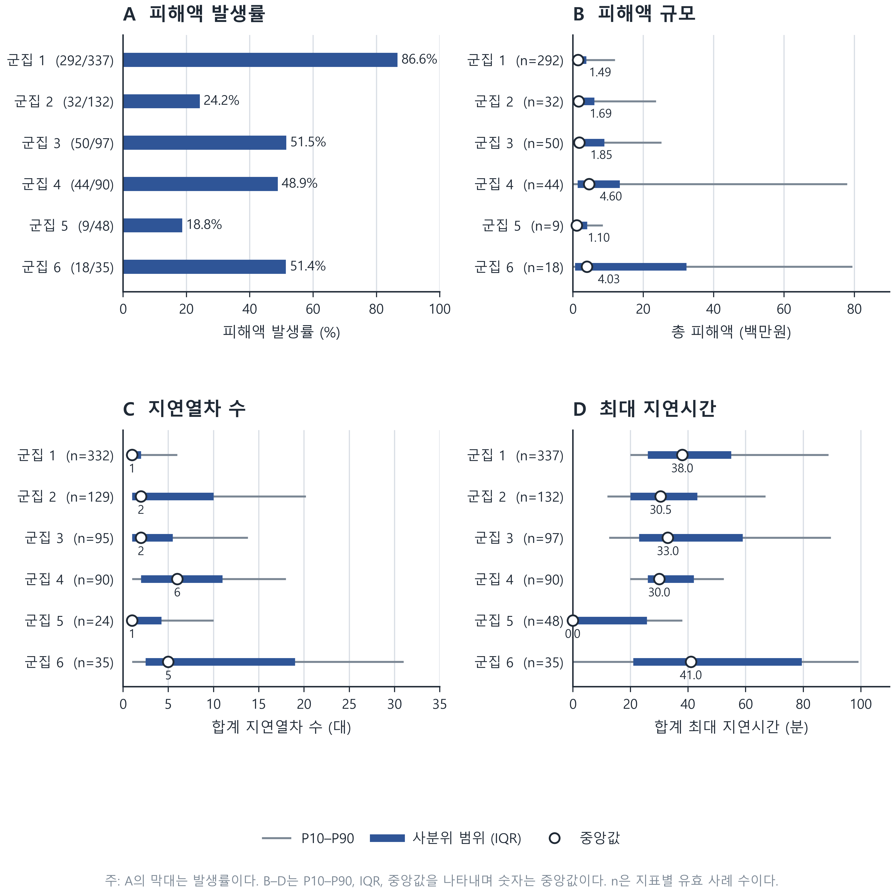

# 철도 운행장애 유형과 피해 특성 분석

한국교통안전공단이 공개한 철도사고·운행장애 자료에서 운행장애 739건을 추려, 범주형 주성분 군집분석(clusCA)과 연관규칙 분석으로 유형을 살펴본 연구의 분석 기록이다. 논문에 사용한 군집 결과와 함께 군집 특성을 확인한 통계, 피해·지연 요약, 표에 실린 연관규칙을 공개한다.

## 분석 흐름

1. 운행장애 사례를 골라 여섯 개 범주형 변수를 정리했다.
2. clusCA를 `K=6`, `d=5`, `nstart=100`, `seed=1234`로 실행했다.
3. 카이제곱 검정과 Haberman 조정 표준화 잔차(ASR)로 군집별 특성을 확인했다.
4. 피해액과 지연 지표를 군집별로 비교했다.
5. 각 군집 안에서 연관규칙을 산출했다. 기준은 지지도 0.20, 신뢰도 0.60, 향상도 1.20이며 한 규칙의 항목 수는 최대 3개다.

세부 절차와 변수 처리 방식은 [분석 과정](docs/analysis-process.md)에 적었다.

## 주요 결과

| 군집 | 사례 수 | 해석에 사용한 이름 |
|---:|---:|---|
| 1 | 337 | 여객열차·차량설비 고장형 |
| 2 | 132 | 도시전동차·복합설비 장애형 |
| 3 | 97 | 외부환경 요인형 |
| 4 | 90 | 신호제어설비 장애형 |
| 5 | 48 | 무정차통과·운전취급 부주의형 |
| 6 | 35 | 전철전력설비·급전장애형 |

군집과 가장 강하게 연결된 변수는 `근본원인별 원인`(Cramér's V=0.798)이었고, `지연운행 현황`(0.763), `지연운행 원인`(0.683)이 뒤를 이었다. 피해액 발생률은 군집 1이 86.6%로 가장 높았지만, 피해액이 발생한 사례만 놓고 본 중앙값은 군집 4와 6이 각각 4.60백만원, 4.03백만원으로 컸다.

군집 1에서는 설정 기준을 넘는 연관규칙이 없었다. 군집 2~6에서는 후보 140개가 나왔고, 향상도·신뢰도·지지도 순으로 정렬해 군집별 3개씩 15개를 논문 표로 정리했다. 전체 수치와 해석은 [분석 결과](docs/results.md)에서 확인할 수 있다.



## 재현 방법

Python 3.11 이상을 기준으로 한다.

```bash
python -m venv .venv
# Windows: .venv\Scripts\activate
# macOS/Linux: source .venv/bin/activate
python -m pip install -r requirements.txt

python -m analysis.cluster_profiles
python -m analysis.impact_summary
python -m analysis.association_rules
python -m pytest -q
```

군집분석을 처음부터 다시 실행하려면 R과 `clustrd` 패키지가 필요하다.

```r
install.packages("clustrd")
```

```bash
Rscript analysis/fit_clusca.R
```

## 저장소 구성

```text
analysis/                  재현 가능한 R·Python 분석 코드
data/processed/            군집분석 입력, 사례 조회표, 군집 결과
notebooks/                 연관규칙 분석 원본 노트북
results/                   코드로 다시 만든 통계표와 연관규칙
outputs/                   논문용 그림과 기존 분석 산출물
tests/                     주요 결과의 회귀 검증
docs/                      분석 과정과 결과 해설
```

원자료 전체는 재배포하지 않는다. `data/processed/`에는 이 연구의 분석을 확인하는 데 필요한 파생 자료만 두었다. 저장소의 군집명은 통계적으로 자동 생성된 명칭이 아니라, ASR과 범주 분포를 바탕으로 연구자가 붙인 해석용 이름이다.

