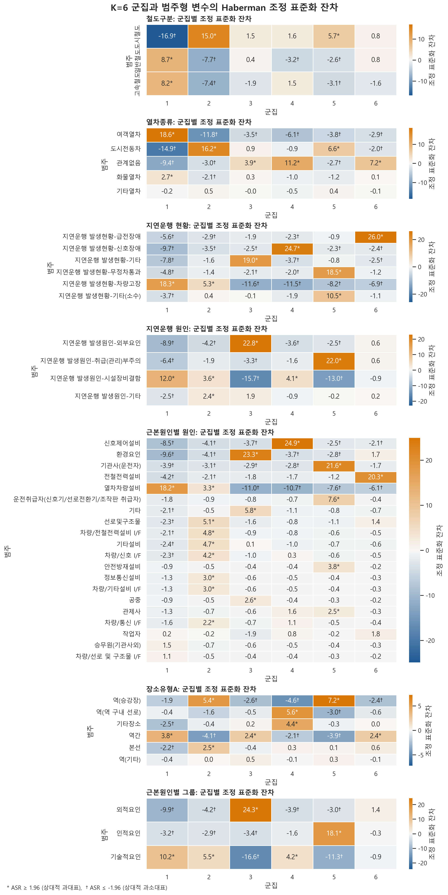
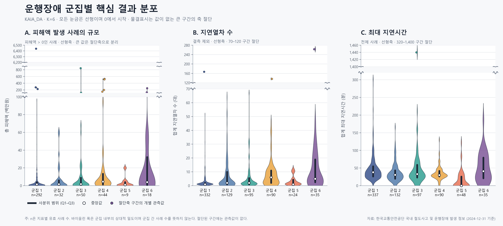

# Classification of Railway Operational Disruptions and Analysis of Damage Characteristics: Using Cluster Correspondence Analysis and Association Rule Mining

철도 운행장애 사례를 유형화하고, 군집별 피해 및 지연 특성을 비교하기 위한 연구 저장소입니다. 이 저장소는 현재 작업 공간에서 확인된 분석 코드, 파생 데이터, 통계표, 실행 노트북과 PNG·SVG·PDF 시각화 결과를 함께 제공합니다.


## 연구 목적

이 연구의 목적은 다음과 같습니다.

1. 범주형 철도 운행장애 자료에 군집 대응분석(Cluster Correspondence Analysis, `clusCA`)을 적용하여 반복적으로 나타나는 운행장애 유형을 분류합니다.
2. 철도구분, 열차종류, 지연운행 현황·원인, 근본원인, 장소유형을 바탕으로 각 군집의 대표 특성을 해석합니다.
3. 군집별 피해액 발생률, 양의 피해액 규모, 지연열차 수, 최대 지연시간을 비교하여 유형별 피해 특성을 파악합니다.
4. 분류 결과를 안전관리·예방정책·우선 대응전략 수립에 활용할 수 있는 재현 가능한 분석 자료로 제공합니다.

## 연구 자료

- 분석 사례: **739건**
- 군집 수: **6개**
- 군집 대응분석 차원: **5차원**
- 적극변수: 철도구분, 열차종류, 지연운행 현황, 지연운행 원인, 근본원인별 원인, 장소유형A
- 보조 해석변수: 근본원인별 그룹
- 피해·지연 지표: 총 피해액, 피해액 발생 여부, 지연열차 수, 최대 지연시간

공개 파일에는 연구용 사례 식별자(`DIS_####`)가 사용되며, 현재 작업 공간에서 확인된 코드와 파생 자료를 그대로 보존했습니다.

## 연구 과정

### 1. 데이터 재구성

분석 노트북의 실행 결과와 사례 자료를 바탕으로 739건의 사례별 범주형 입력자료와 피해·지연 지표를 재구성했습니다. 재구성 및 시각화용 자료 생성 과정은 `work/rebuild_plot_data.py`, `work/build_visualization_dataset.py` 및 관련 스크립트에 기록되어 있습니다.

### 2. 군집 대응분석

R 패키지 `clustrd`의 `tuneclus()`를 이용해 다음 조건의 고정해를 적합했습니다.

- 방법: `clusCA`
- 군집 수: `k = 6`
- 차원 수: `d = 5`
- 기준: 평균 실루엣 폭(ASW) 및 Calinski-Harabasz(CH)
- 다중 시작값: `nstart = 100`
- 난수 시드: `1234`

분석 코드에는 100회 부트스트랩 Jaccard 안정성 평가 절차도 포함되어 있습니다.

### 3. 군집 프로파일링

군집과 범주형 변수의 교차표를 구성한 뒤 Haberman 조정 표준화 잔차(Adjusted Standardized Residual, ASR)를 계산했습니다. 양의 `ASR >= 1.96`인 범주를 상대적 과대표 범주로 보고, 각 군집×변수 조합에서 값이 큰 범주를 최대 2개까지 선정했습니다.

적극변수는 군집 형성에 직접 사용되었으므로 카이제곱 검정과 ASR은 독립적인 확인적 검정이 아니라 **탐색적 군집 프로파일링 지표**로 해석해야 합니다.

### 4. 피해 및 지연 특성 비교

- 피해액 발생률: 군집별 양의 피해액 사례 비율
- 양의 피해액: P10-P90, 사분위 범위(IQR), 중앙값
- 지연열차 수: P10-P90, IQR, 중앙값
- 최대 지연시간: P10-P90, IQR, 중앙값

분포의 비대칭성과 극단값 영향을 고려해 평균 대신 중앙값과 분위수 구간을 중심으로 시각화했습니다.

### 5. 결과 시각화 및 산출물 생성

Python, R, Jupyter Notebook 및 JavaScript 기반 스크립트를 이용하여 ASR 히트맵, 바이올린 플롯, 논문용 구간 그림, 통계 CSV, Excel 데이터셋을 생성했습니다.

## 연구 결과

### 군집 규모와 대표 유형

| 군집 | 사례 수 | 대표 유형 | 주요 과대표 특성 |
|---:|---:|---|---|
| 1 | 337 | 차량설비형 | 여객열차, 차량고장, 열차차량설비, 일반·고속철도 |
| 2 | 132 | 도시전동차 차량고장형 | 도시철도, 도시전동차, 승강장, 차량고장 |
| 3 | 97 | 외적 환경요인형 | 외적요인, 환경요인, 외부요인 |
| 4 | 90 | 신호설비형 | 신호제어설비, 신호장애, 역 구내 선로 |
| 5 | 48 | 인적 취급오류형 | 기관사·운전취급자, 관리부주의, 무정차통과 |
| 6 | 35 | 전철전력형 | 전철전력설비, 급전장애 |

### 범주형 변수와 군집의 연관성

| 변수 | Cramer's V | 해석상 특징 |
|---|---:|---|
| 근본원인별 원인 | 0.798 | 군집 구분과 가장 강한 연관 |
| 근본원인별 그룹 | 0.793 | 보조변수에서도 뚜렷한 유형 차이 |
| 지연운행 현황 | 0.763 | 차량고장·신호장애·급전장애 등이 군집을 구분 |
| 지연운행 원인 | 0.683 | 시설장비결함·외부요인·관리부주의가 구분에 기여 |
| 철도구분 | 0.511 | 일반·고속·도시철도 간 차이 |
| 열차종류 | 0.473 | 여객열차·도시전동차 등의 차이 |
| 장소유형A | 0.214 | 다른 변수보다 상대적으로 약한 연관 |

일부 변수는 기대빈도 5 미만 셀이 많으므로 개별 ASR과 p값은 탐색적으로 해석해야 합니다.

### 군집별 피해·지연 중앙값

| 군집 | 피해액 발생률 | 양의 피해액 중앙값 (백만원) | 지연열차 수 중앙값 | 최대 지연시간 중앙값 (분) |
|---:|---:|---:|---:|---:|
| 1 | 86.6% | 1.49 | 1 | 38.0 |
| 2 | 24.2% | 1.69 | 2 | 30.5 |
| 3 | 51.5% | 1.85 | 2 | 33.0 |
| 4 | 48.9% | 4.60 | 6 | 30.0 |
| 5 | 18.8% | 1.10 | 1 | 0.0 |
| 6 | 51.4% | 4.03 | 5 | 41.0 |

핵심적으로 군집 1은 피해액 발생률이 가장 높고, 군집 4는 양의 피해액과 지연열차 수 중앙값이 가장 높았습니다. 군집 6은 최대 지연시간 중앙값이 가장 길었습니다. 이 차이는 사고 유형별로 피해 저감과 운행 복구 전략을 구분할 필요가 있음을 보여줍니다.

## 주요 시각화

### 논문용 피해·지연 특성 그림


- 벡터 형식: [`SVG`](outputs/kaia-k6-paper-figure/KAIA_DA_k6_paper_interval_figure.svg)
- 인쇄 형식: [`PDF`](outputs/kaia-k6-paper-figure/KAIA_DA_k6_paper_interval_figure.pdf)
- 통계표: [`CSV`](outputs/kaia-k6-paper-figure/KAIA_DA_k6_paper_interval_statistics.csv)

### ASR 히트맵



### 군집별 분포 시각화



## 저장소 구성

```text
.
├── README.md
├── outputs/
│   ├── KAIA_DA_k=6_ASR_analysis.ipynb
│   ├── KAIA_DA_k=6_with_ASR.R
│   ├── KAIA_DA_k=6_ASR_*.csv
│   ├── KAIA_DA_k=6_ASR_heatmaps.png
│   ├── kaia-k6-paper-figure/
│   ├── kaia-k6-violin/
│   └── kaia-k6-visualization-data/
└── work/
    ├── *.py
    ├── *.R
    ├── *.mjs
    └── plot_data_rebuild/
```

`work/Rlibs`, `work/node_modules`, `__pycache__` 및 임시 PDF 렌더링 파일은 로컬 의존성·캐시이므로 저장소에서 제외합니다.

## 재현 방법

### Python 시각화

저장소 루트에서 다음과 같이 실행합니다.

```bash
python work/create_paper_interval_figure.py
python work/create_violin_plot.py
```

주요 Python 의존성은 `pandas`, `numpy`, `matplotlib`, `openpyxl`입니다. 한글 글꼴은 Windows의 `Malgun Gothic`을 우선 사용하고, 사용할 수 없으면 대체 sans-serif 글꼴을 사용합니다.

### R 군집 대응분석 및 ASR

```r
source("outputs/KAIA_DA_k=6_with_ASR.R")
```

R 패키지 `clustrd`가 필요합니다. 원 분석 스크립트에는 연구 당시의 로컬 경로가 기록되어 있으므로 다른 환경에서 실행할 때 `base_dir`와 입력 파일 경로를 조정해야 합니다.

### 분석 노트북

`outputs/KAIA_DA_k=6_ASR_analysis.ipynb`에서 데이터 무결성 확인, 카이제곱·Cramer's V·ASR 계산, 군집별 대표 특성 및 히트맵 생성 과정을 확인할 수 있습니다.

## 해석상 주의사항

- 군집 형성에 사용된 적극변수에 대한 카이제곱과 ASR은 외부 타당화가 아니라 군집 해석을 위한 기술적 결과입니다.
- 기대빈도가 작은 셀이 포함된 변수는 p값보다 효과크기와 패턴을 함께 검토해야 합니다.
- 군집별 피해액과 지연지표는 표본 크기가 다르며, 일부 지표는 결측치 또는 0을 포함합니다.
- 본 저장소에는 현재 작업 공간에서 확인된 군집 대응분석, ASR 및 피해·지연 특성 분석 산출물을 수록했습니다. 연구 제목에 포함된 연관규칙 분석의 별도 코드·결과 파일은 현재 작업 공간에서 확인되지 않아 임의로 생성하거나 결과를 과장하지 않았습니다.

## 파일 범위와 출처

이 저장소는 현재 분석 세션에서 확인된 연구용 파일을 공개하기 위한 아카이브입니다. 로컬 실행환경의 설치 패키지, 캐시, 임시 렌더링 파일은 제외하며, 분석 코드·파생 자료·표·노트북·최종 시각화는 보존합니다.

